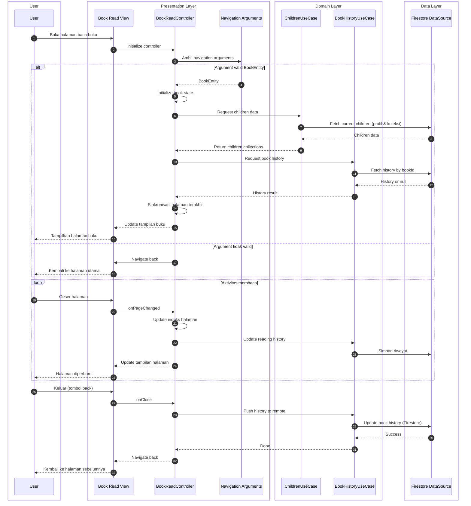

# Sequence Diagram: Alur Membaca Buku dengan Data Anak (Clean Architecture)

Diagram ini menggambarkan interaksi pengguna dengan fitur baca buku serta alur data profil anak dan riwayat bacaan mengikuti lapisan Clean Architecture. Diagram dibuat untuk keperluan skripsi sehingga menggunakan istilah yang umum dan tidak terlalu teknis.

---

## Diagram

---

## Keterangan Ringkas

| Lapisan | Peran | File terkait |
|--------|--------|----------------|
| **Presentation** | Book Read View menampilkan UI; BookReadController menangani input dan memanggil use case; Navigation Arguments membawa data buku (BookEntity). | `book_read_page.dart`, `book_read_controller.dart` |
| **Domain** | ChildrenUseCase mengurus data anak (profil, koleksi); BookHistoryUseCase mengurus riwayat bacaan (fetch & update). Di kode aktual, keduanya diimplementasikan lewat `ChildrenUsecase` dan `ChildrenRepository`. | `children_usecase.dart`, `children_repository.dart` |
| **Data** | Firestore DataSource mengakses Firebase/Firestore untuk data anak dan riwayat buku. | `children_remote_data_source.dart`, `children_repository_impl.dart` |

Alur yang digambarkan:

1. **User membuka halaman baca buku** → Controller mengambil argument navigasi (BookEntity) → jika valid, meminta data anak dan riwayat buku lewat use case → Data Layer (FS) mengambil dari Firestore → tampilan buku diperbarui.
2. **Loop aktivitas membaca** → User geser halaman → Controller update indeks dan meminta update riwayat lewat HistoryUC → FS menyimpan riwayat.
3. **User keluar** → Controller memicu push history ke remote → HistoryUC memanggil FS untuk update di Firestore → navigasi kembali.

Dependency mengalir dari Presentation → Domain → Data, sesuai Clean Architecture.
