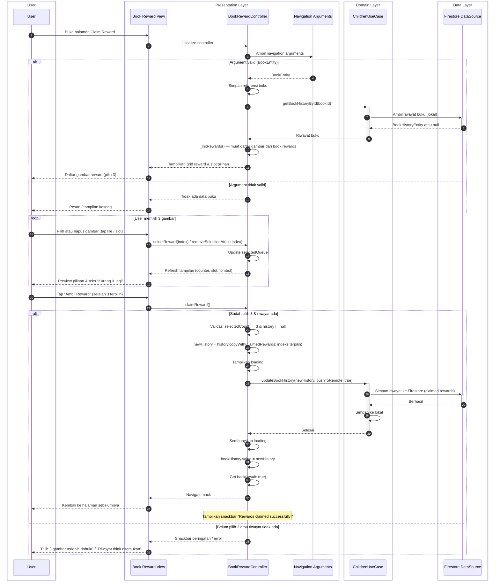

# Sequence Diagram: Alur Claim Reward (Clean Architecture)

Diagram ini menggambarkan alur pengguna mengklaim reward buku setelah menyelesaikan quiz. Pengguna memilih 3 gambar reward; data riwayat buku (termasuk reward yang diklaim) disimpan melalui Children Use Case ke Firestore dan penyimpanan lokal. Diagram mengikuti format skripsi dan lapisan Clean Architecture.

---

## Diagram

---

## Keterangan Ringkas

| Lapisan | Peran | File terkait |
|--------|--------|----------------|
| **Presentation** | Book Reward View menampilkan grid gambar reward, slot pilihan (3), dan tombol "Ambil Reward"; BookRewardController menerima argument (BookEntity), memuat riwayat buku via getBookHistoryById, menginisialisasi daftar reward dari book.rewards, menangani pilihan pengguna (selectReward, removeSelectionAt), dan saat claim memanggil ChildrenUseCase.updateBookHistory dengan pushToRemote: true. | `book_reward_page.dart`, `book_reward_controller.dart` |
| **Domain** | ChildrenUseCase menyediakan getBookHistoryById dan updateBookHistory; untuk claim, updateBookHistory dipanggil dengan pushToRemote: true agar riwayat (termasuk claimedRewards) disinkronkan ke server. | `children_usecase.dart`, `children_repository.dart` |
| **Data** | Firestore DataSource (via repository impl) mengambil riwayat buku dari lokal (getBookHistoryById); saat claim, updateBookHistory menulis ke Firestore lalu menyimpan salinan ke lokal. | `children_repository_impl.dart`, `children_remote_data_source.dart` |

Alur yang digambarkan:

1. **Masuk halaman reward**  
   User membuka halaman Claim Reward (dari halaman quiz setelah jawaban benar). Controller mengambil argument (BookEntity), memanggil ChildrenUseCase.getBookHistoryById(bookId) untuk mendapatkan riwayat buku saat ini, lalu _initRewards() mengisi daftar gambar dari book.rewards. UI menampilkan grid reward dan slot untuk 3 pilihan.

2. **Memilih 3 gambar**  
   User memilih atau menghapus pilihan lewat tap pada tile atau slot. Controller meng-update selectedQueue; tombol "Ambil Reward" aktif hanya jika selectedCount == 3.

3. **Claim reward**  
   User mengetuk "Ambil Reward". Controller memvalidasi (3 gambar terpilih dan riwayat ada), membentuk newHistory dengan claimedRewards berisi indeks terpilih, menampilkan loading, lalu memanggil ChildrenUseCase.updateBookHistory(newHistory, pushToRemote: true). Use case memicu penyimpanan ke Firestore (data layer) dan ke lokal. Setelah selesai, loading disembunyikan, controller meng-update state, memanggil Get.back(result: true), dan menampilkan snackbar sukses.

Dependency mengalir dari Presentation → Domain → Data, sesuai Clean Architecture.
