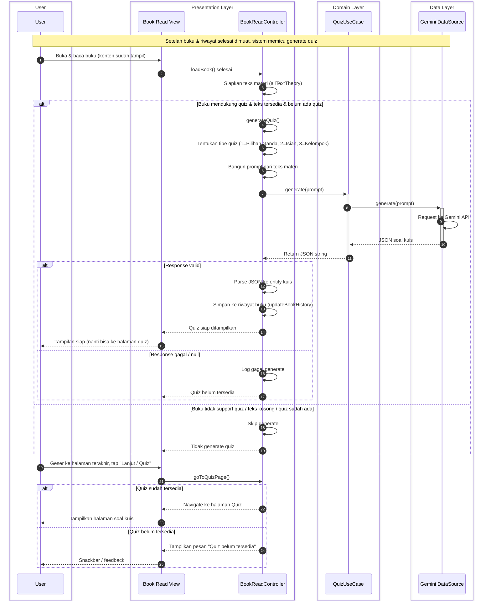

# Sequence Diagram: Alur Generate Quiz (Clean Architecture)

Diagram ini menggambarkan alur pembuatan soal kuis berdasarkan materi buku yang baru selesai dimuat. Generate quiz dipicu otomatis setelah halaman baca buku selesai memuat konten dan riwayat. Diagram mengikuti format skripsi (tidak terlalu teknis) dan lapisan Clean Architecture.

---

## Diagram

---

## Keterangan Ringkas

| Lapisan | Peran | File terkait |
|--------|--------|----------------|
| **Presentation** | Book Read View menampilkan PDF dan tombol navigasi; BookReadController memicu generateQuiz setelah loadBook, membangun prompt dari teks materi, memanggil use case, lalu mem-parse hasil dan menyimpan ke riwayat buku. | `book_read_page.dart`, `book_read_controller.dart` |
| **Domain** | QuizUseCase menyediakan operasi generate(prompt); tidak bergantung pada sumber data konkret. | `quiz_usecase.dart`, `quiz_repository.dart` |
| **Data** | Gemini DataSource memanggil API Gemini (generateContent) dengan prompt dan mengembalikan respons JSON. | `quiz_remote_data_source.dart`, `quiz_repository_impl.dart` |

Alur yang digambarkan:

1. **Pemicu generate**  
   Setelah buku dan riwayat selesai dimuat, controller memanggil `generateQuiz()`. Jika buku mendukung quiz, ada teks materi, dan belum ada quiz yang sudah digenerate, controller membangun prompt sesuai tipe quiz (1= Pilihan Ganda, 2= Isian Rumpang, 3= Kelompok) lalu memanggil QuizUseCase.

2. **Generate soal**  
   QuizUseCase memanggil repository → implementasi memanggil Gemini DataSource → request ke Gemini API → respons JSON dikembalikan ke controller. Controller mem-parse JSON ke entity, lalu menyimpan ke riwayat buku (via updateBookHistory).

3. **Interaksi pengguna**  
   Pengguna membalik sampai halaman terakhir lalu mengetuk tombol lanjut/quiz. Controller memeriksa apakah quiz sudah tersedia; jika ya, navigasi ke halaman quiz; jika tidak, menampilkan pesan "Quiz belum tersedia".

Dependency mengalir dari Presentation → Domain → Data, sesuai Clean Architecture.
