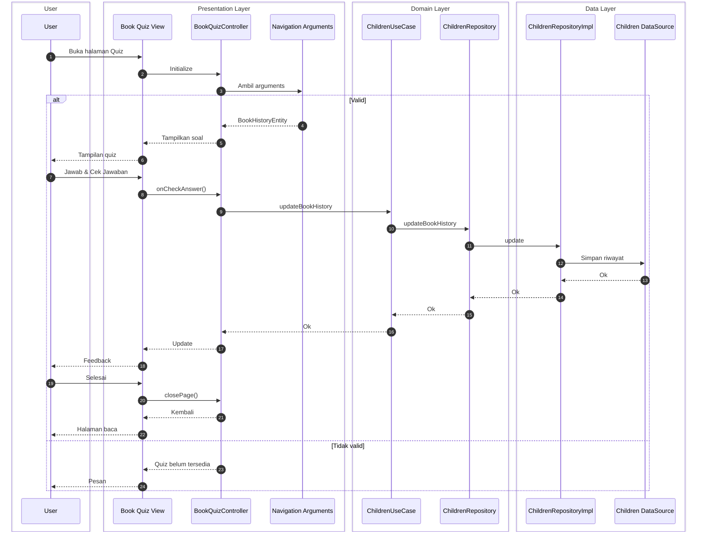

# Sequence Diagram: Alur Play Quiz (Clean Architecture)

Alur mengerjakan quiz (play quiz): pengguna membuka halaman Quiz, mengisi jawaban, dan menyimpan riwayat melalui semua lapisan Clean Architecture (Presentation → Domain → Data). Tingkat detail sedang, cocok untuk skripsi.

---

## Diagram

---

## Keterangan Ringkas

| Lapisan | Komponen | Peran |
|--------|----------|--------|
| **Presentation** | Book Quiz View, BookQuizController | UI menampilkan soal dan tombol Cek Jawaban; Controller ambil NAV args, kelola state jawaban, panggil Use Case untuk simpan riwayat. |
| **Domain** | ChildrenUseCase, ChildrenRepository | Use Case memanggil Repository; Repository kontrak akses data riwayat buku. |
| **Data** | ChildrenRepositoryImpl, Children DataSource | Repo Impl meneruskan updateBookHistory ke DataSource (lokal/remote); data disimpan lalu dikembalikan. |

Alur: User buka halaman Quiz → Controller ambil arguments → jika valid, tampilkan soal. Saat user pilih jawaban dan tap Cek Jawaban, Controller evaluasi lalu memanggil ChildrenUseCase → Repository → Repository Impl → DataSource (simpan riwayat) → balik ke UI untuk feedback. User selesai/back → closePage → kembali ke halaman baca. Dependency: Presentation → Domain → Data (Clean Architecture).
