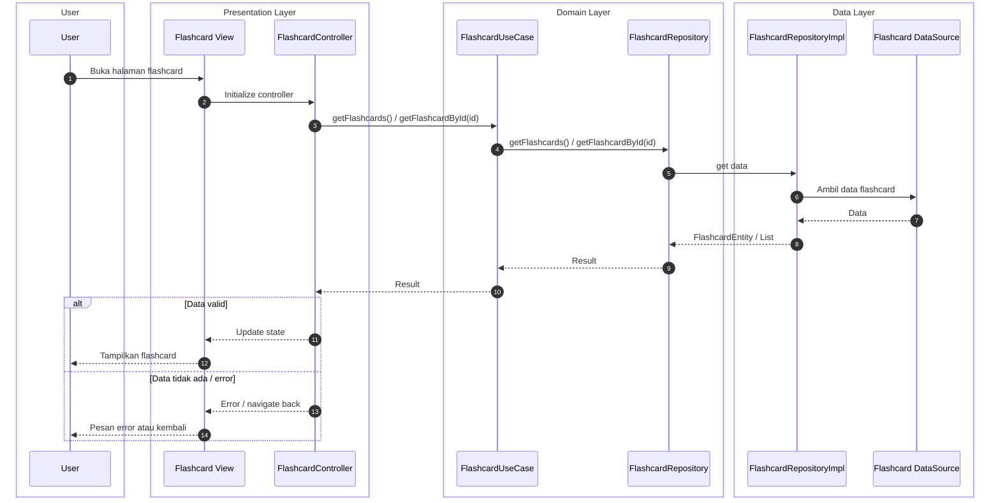

# Sequence Diagram: Proses Menampilkan Flashcard (Show Flashcard)

Alur menampilkan flashcard (Clean Architecture): buka halaman → muat data lewat Use Case & Repository → tampilkan ke user. Detail sedang, cocok untuk skripsi.

---

## Diagram

---

## Keterangan Ringkas

| Lapisan | Komponen | Peran |
|--------|----------|--------|
| **Presentation** | Flashcard View, Controller | UI menampilkan data; Controller panggil Use Case dan update state. |
| **Domain** | FlashcardUseCase, FlashcardRepository | Use Case orkestrasi; Repository kontrak akses data. |
| **Data** | FlashcardRepositoryImpl, DataSource | Repo Impl ambil dari DataSource, kembalikan entity ke domain. |

Alur: User buka halaman → UI inisialisasi Controller → Controller panggil Use Case → Use Case panggil Repository → Repo Impl ambil dari DataSource → data kembali ke UI → tampilkan atau error. Clean Architecture: Presentation → Domain → Data.
