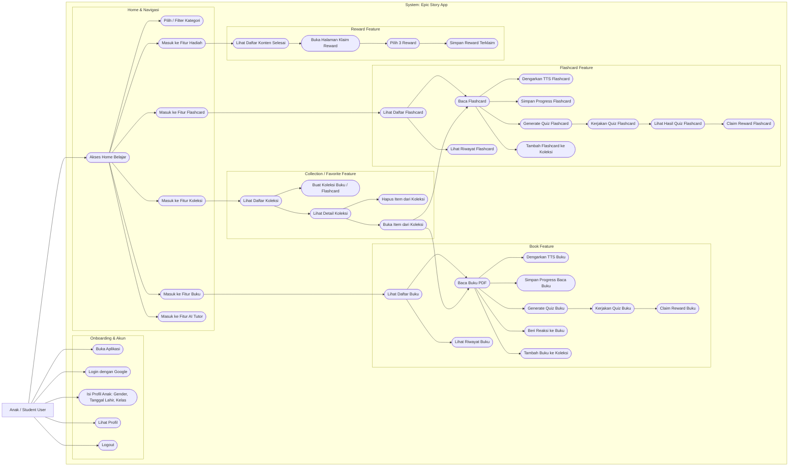

# Use Case Diagram - Epic Story App

Dokumen ini merangkum use case utama lintas fitur aplikasi: onboarding, book, flashcard, collection (favorite), reward, profile, serta layanan eksternal.

## Catatan

- Fitur AI Tutor saat ini masih berupa halaman placeholder, tetapi tetap dimasukkan sebagai use case agar peta fitur lengkap.
- Istilah collection pada project direpresentasikan melalui modul Favorite/Koleksi (create, detail, add/remove item).
- Diagram ini fokus pada level bisnis pengguna (high-level), bukan detail implementasi kelas.
- Actor pada diagram disederhanakan menjadi satu actor utama: siswa/pengguna aplikasi.
